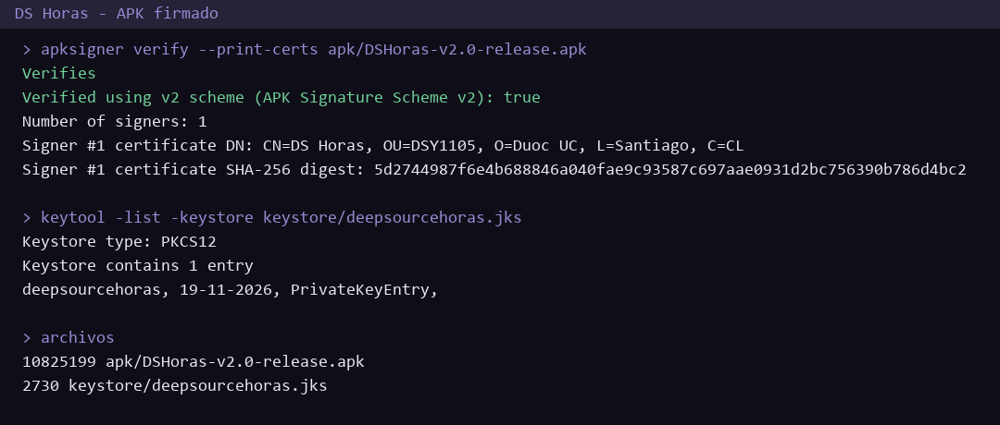

# DS Horas

App Android para registrar las horas de trabajo por proyecto. Se hizo para Deepsource en Vinculación con el Medio de Duoc UC, ramo Desarrollo de Aplicaciones Móviles (DSY1105), Evaluaciones Parciales 4 y 5. Las horas se pueden anotar desde la app o desde un widget en la pantalla de inicio.

| Parte | Tecnología | Carpeta |
|---|---|---|
| App móvil | Kotlin + Jetpack Compose (MVVM) | `app/` |
| Microservicio de usuarios | Spring Boot 3.5 + JPA | `microservicios/ms-usuarios/` |
| Microservicio de horas | Spring Boot 3.5 + JPA | `microservicios/ms-horas/` |
| Base de datos | Supabase (PostgreSQL), o H2 local si no hay `supabase.properties` | `supabase/` |

```
App Android ──Retrofit──► API Spring Boot (8081 / 8082) ──JDBC──► Supabase (PostgreSQL)
```

## 1. Nombre del proyecto

DS Horas: registro de horas por proyecto para Deepsource.

## 2. Integrantes

| Integrante | Rol |
|---|---|
| Javier Vásquez | Scrum Master y desarrollo (base de datos, cronómetro, widgets y APK) |
| Carlos Salfate Olivares | Product Owner y desarrollo frontend (backlog y diseño en Figma) |
| Vicente Quilaleo | QA y desarrollo de apoyo (pruebas y pantallas como splash y login) |

## 3. Funcionalidades

- **Login** contra `ms-usuarios`, con contraseñas guardadas con BCrypt. La sesión queda guardada.
- **Home** con los proyectos activos, su avance, el total de horas y los últimos registros.
- **Registro de horas** con proyecto, día, horas, minutos, tarea y foto opcional (cámara o galería). Valida mientras se escribe: máximo 24 horas, 59 minutos y 24 horas por día. Avisa si el día elegido es feriado.
- **Cronómetro con pausa**: Iniciar, Pausar/Reanudar y Finalizar. Al finalizar rellena las horas y minutos. Sigue corriendo si se cierra la app y se muestra en una notificación.
- **Mis registros**: lista con editar y eliminar.
- **Mis proyectos**: filtro en curso/finalizados, crear proyecto y finalizar proyecto.
- **Aporte del equipo**: cada registro guarda su autor. En cada proyecto se ven las horas y el porcentaje de cada integrante.
- **Sin conexión**: si los microservicios no responden, la app avisa y muestra la copia guardada en el teléfono (SQLite).

### Widgets

Son 5, redimensionables y con vista previa en el selector. El cronómetro es el mismo en la app, la notificación y los widgets.

| Widget | Tamaño inicial | Qué hace |
|---|---|---|
| Proyectos y registro | 4×3 | Horas por proyecto y botón "Registrar horas". Con cronómetro activo muestra el tiempo, Pausar/Reanudar y Finalizar |
| Proyectos | 4×3 | Lista de proyectos en curso, cada uno con un botón para iniciar su cronómetro |
| Cronómetro | 3×2 | Cronómetro del proyecto en curso, con Pausar/Reanudar y Finalizar |
| Resumen | 4×2 | Horas de hoy y de la semana |
| Mini | 1×1 | Muestra el tiempo; al tocarlo pausa o reanuda |

### Recursos nativos

| Recurso | Uso | Permiso |
|---|---|---|
| Notificaciones | Aviso "Horas registradas" y notificación del cronómetro | `POST_NOTIFICATIONS` |
| Cámara | Foto de evidencia | `CAMERA` |
| Galería | Elegir una foto con el selector de Android | Ninguno |
| Vibración | Al iniciar, pausar, guardar y en errores | `VIBRATE` |
| Internet | Microservicios y API de feriados | `INTERNET` |

## 4. Endpoints de la API

### `ms-usuarios` (puerto 8081)

| Método | Endpoint | Descripción | Usada por la app |
|---|---|---|---|
| POST | `/api/auth/login` | Login. Recibe `{"email","password"}` y devuelve `{"token","id","nombre","email"}`; 401 si no coincide | Sí |
| GET | `/api/usuarios` | Listar usuarios | No |
| GET | `/api/usuarios/{id}` | Ver un usuario | No |
| POST | `/api/usuarios` | Crear usuario `{"nombre","email","password"}` | No |
| PUT | `/api/usuarios/{id}` | Actualizar usuario | No |
| DELETE | `/api/usuarios/{id}` | Eliminar usuario | No |

### `ms-horas` (puerto 8082)

| Método | Endpoint | Descripción | Usada por la app |
|---|---|---|---|
| GET | `/api/proyectos` | Listar proyectos | Sí |
| GET | `/api/proyectos/{id}` | Ver un proyecto | No |
| GET | `/api/proyectos/{id}/aportes` | Horas y porcentaje de cada integrante | No |
| POST | `/api/proyectos` | Crear proyecto `{"nombre","cliente"}` | Sí |
| PUT | `/api/proyectos/{id}` | Actualizar proyecto | No |
| PATCH | `/api/proyectos/{id}/finalizar` | Finalizar proyecto | Sí |
| DELETE | `/api/proyectos/{id}` | Eliminar (solo si no tiene horas) | No |
| GET | `/api/registros?limite=5` | Listar registros | Sí |
| GET | `/api/registros/{id}` | Ver un registro | No |
| GET | `/api/registros/minutos-dia?fecha=2026-11-19` | Minutos usados y disponibles del día | No |
| POST | `/api/registros` | Crear registro `{"proyectoId","tarea","fecha","minutos","foto","usuarioId","usuarioNombre"}` | Sí |
| PUT | `/api/registros/{id}` | Editar registro | Sí |
| DELETE | `/api/registros/{id}` | Eliminar registro | Sí |

Los endpoints marcados "No" completan el CRUD y se pueden probar desde el navegador o Postman. Los errores vuelven como `{"mensaje": "..."}`. El servidor valida lo mismo que la app: día no futuro, máximo 24 horas por día, proyecto en curso y tarea de 3 a 60 caracteres.

### API externa

| API | Endpoint | Uso |
|---|---|---|
| [Nager.Date](https://date.nager.at) (pública, sin llave) | `GET https://date.nager.at/api/v3/PublicHolidays/{año}/CL` | Aviso de feriado en el formulario |

Se consume con Retrofit (`FeriadosApi`).

## 5. Pasos para ejecutar

Requisitos: Android Studio (incluye el JDK que usan los microservicios) y un emulador o un teléfono con depuración USB.

### a) Base de datos

Seguir [`supabase/README.md`](supabase/README.md): crear el proyecto en Supabase, ejecutar `supabase/schema.sql` en el SQL Editor y completar `microservicios/supabase.properties` a partir de `supabase.properties.ejemplo`. Ese archivo tiene la clave de la base y no se sube a GitHub. Sin él, los microservicios usan H2 local con las mismas tablas.

### b) Abrir la app

1. Abrir la carpeta del proyecto en Android Studio y esperar el Gradle Sync.
2. Elegir el emulador y presionar Run.
3. Entrar con una cuenta de prueba, todas con clave `123456`: `usuario@deepsource.io`, `carla@deepsource.io` o `diego@deepsource.io`.

La app usa `10.0.2.2`, que es el `localhost` del PC visto desde el emulador. Para un teléfono físico:

- Opción 1, por USB:
  ```
  adb reverse tcp:8081 tcp:8081
  adb reverse tcp:8082 tcp:8082
  gradlew installDebug -Papi.host=127.0.0.1
  ```
- Opción 2, con la IP del PC: `gradlew installDebug -Papi.host=192.168.1.X` y agregar esa IP en `app/src/main/res/xml/network_security_config.xml`.

### c) Widgets

Mantener presionado un espacio vacío de la pantalla de inicio, entrar a Widgets, buscar "DS Horas", elegir uno y tocar Add.

### d) Pruebas unitarias

```
gradlew coberturaLogica
```

Corre las pruebas de la app (JUnit 4, MockK y coroutines-test) y genera el reporte de cobertura en `app/build/reports/jacoco/coberturaLogica/html/index.html`.

Los microservicios tienen sus propias pruebas (JUnit 5 y Mockito): `gradlew test` dentro de cada carpeta. `SupabaseCompatibilidadTest` levanta un PostgreSQL 16 real, ejecuta `supabase/schema.sql` y comprueba que las tablas calcen con el código.

## 6. APK firmado

- APK: [`apk/DSHoras-v2.0-release.apk`](apk/DSHoras-v2.0-release.apk)
- Llave: [`keystore/deepsourcehoras.jks`](keystore/deepsourcehoras.jks) (alias `deepsourcehoras`)
- Configuración: [`keystore.properties`](keystore.properties) y el bloque `signingConfigs` de [`app/build.gradle.kts`](app/build.gradle.kts)

Para generarlo de nuevo: `gradlew assembleRelease`, que deja el archivo en `app/build/outputs/apk/release/app-release.apk`. También se puede desde Build → Generate Signed App Bundle / APK, eligiendo el `.jks` de la carpeta `keystore`.

Verificación de la firma (`apksigner verify --print-certs`):



La llave es de prueba para la evaluación, por eso está en el repositorio. En un proyecto real no se sube.

## Arquitectura

La app usa MVVM con Jetpack Compose. Cada pantalla tiene un ViewModel con un `StateFlow` y la pantalla solo dibuja el estado. Las dependencias se pasan por constructor (`di/`), así los ViewModel se prueban con simulados.

```
com.example.deepsourcehoras/
├── data/
│   ├── remote/         Retrofit: HorasApi, UsuariosApi, FeriadosApi y DTO
│   ├── local/          SQLite: copia local de proyectos y registros
│   ├── preferences/    Sesión y cronómetro (SharedPreferences)
│   └── repository/     AuthRepository, HorasRepository, FeriadosRepository
├── di/                 Dependencias y fábricas de ViewModel
├── domain/             Validaciones, cronómetro y cálculo de aportes
├── model/              Estados de pantalla y errores
├── recursos/           Notificaciones, cámara y vibración
├── navigation/         Rutas y NavHost
├── ui/                 Pantallas, componentes, tema y ViewModels
├── util/               Formato de fechas y duraciones
└── widget/             5 widgets con Jetpack Glance
```

`HorasRepository` escribe en `ms-horas` y con la respuesta actualiza la copia en SQLite. Las pantallas leen esa copia.

Los microservicios siguen las capas `controller → service → repository (JPA) → model`, con DTO, validación `@Valid` y un `@RestControllerAdvice` para los errores.

## Planificación

Tablero de Trello: (pegar link)

Repositorio: (pegar link de GitHub)
